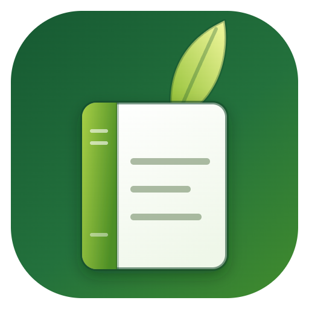
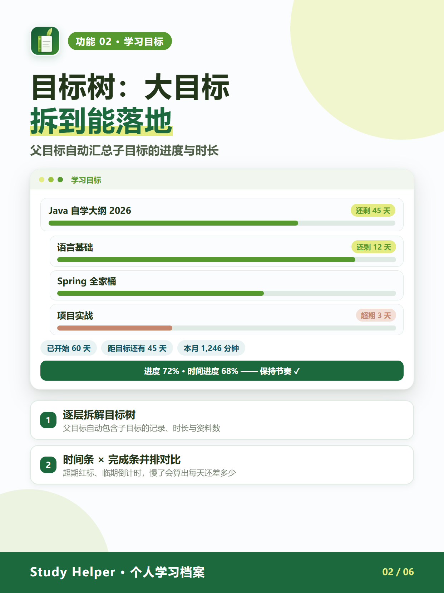
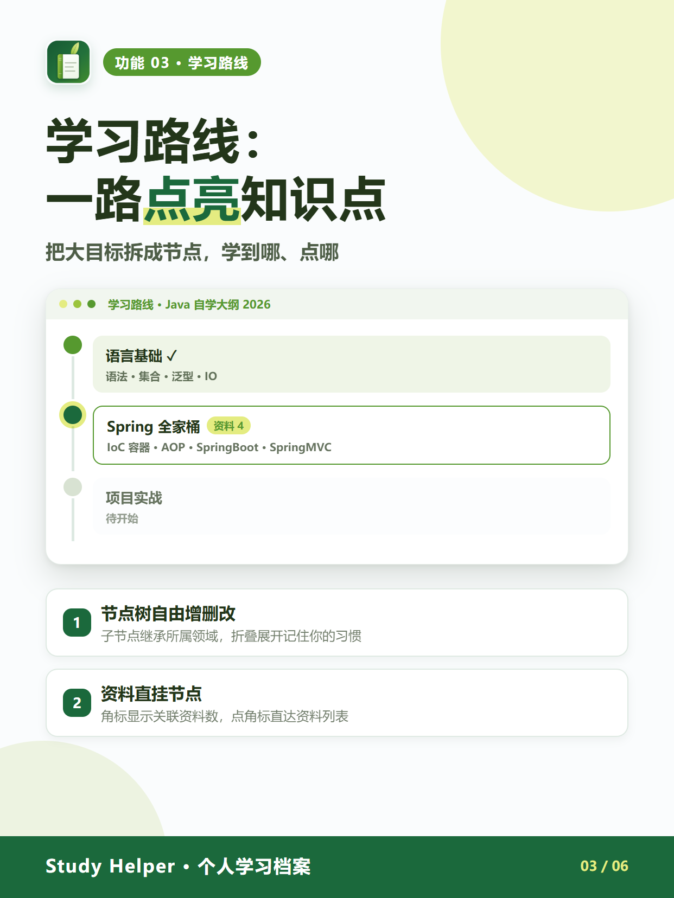
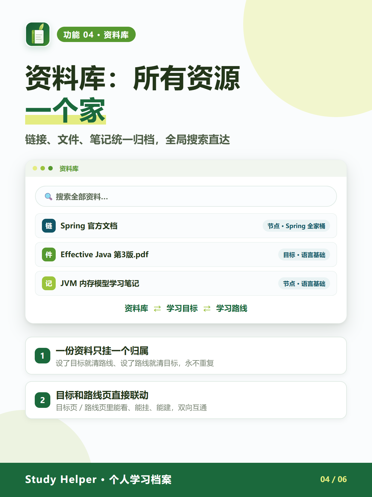

<div align="center">



# Study Helper

**个人学习档案 · 记录优先，不评价不监工**


</div>

---

## 这是什么

一个给「想安静记录学习」的人做的 Windows 桌面应用：

- **记录优先** —— 只帮你把目标、路线、资料、心得记下来，没有社交、没有排行、不催你打卡
- **数据 100% 本地** —— SQLite 单文件库就存在应用自己目录下，不登录、不上传、离线可用
- **字段最少** —— 记一条学习只用填「学了什么、多久」，其他全是可选项
- **全局搜索** —— 搜目标是搜树、搜资料是搜库，一个搜索框直达

## 功能速览

| 学习目标 | 学习路线 |
|:---:|:---:|
|  |  |
| 目标树逐层拆解，父目标自动汇总子目标的进度、时长与资料数；起始/截止时间与完成进度并排对比，超期红标、临期倒计时 | 大目标拆成节点一路点亮；资料直挂节点，角标显示关联资料数；折叠状态记住你的习惯 |
| **资料库** | **便签墙 + 打卡** |
|  |  |
| 链接、文件、笔记统一归档；一份资料只挂一个归属，与目标 / 学习路线双向联动；全局搜索直达 | 两块便签板自由拖拽、位置各自记忆；打卡项与目标解耦，连续天数自动计算 |
| **数据安全** | |
|  | |
| 数据存在本地 SQLite 单文件；一键备份自动保留最近 14 份；整库拷走即迁移；六套主题随心换 | |

其他细节：学习记录支持时长/数量两种量化方式并写心得感想、概览页便签墙 + 统计热力图、愿望清单与项目集、以及自绘无边框窗口与六套主题（leaf / guava / soda / hawthorn / orange / allgrey）。

## 下载安装

前往 [**Releases**](../../releases) 页面下载：

| 文件 | 说明 |
|---|---|
| `Study-Helper-Setup-x.y.z.exe` | 安装版（NSIS 安装向导），推荐 |
| `Study-Helper-x.y.z-x64.zip` | 免安装便携版，解压即用 |

- 无需管理员权限；数据存放在应用目录下的 `data/` 文件夹，卸载前请自行备份该目录
- 系统要求：Windows 10 / 11（x64）

## 数据存储与备份

```
<应用目录>/
└── data/
    └── learning-hut.db    ← 你的全部数据（SQLite 单文件，含 WAL）
```

- 应用内 **设置 → 数据 → 立即备份** 可随时手动备份，自动保留最近 14 份
- **换电脑 / 迁移**：退出应用后把整个 `data/` 拷到新位置即可（记得连 `-wal` / `-shm` 一起拷）
- 数据目录不可写时会自动退到 `%LOCALAPPDATA%\Study Helper\data`

## 本地开发

```bash
# 依赖：Node.js 22+
npm install

# 开发调试（热更新）
npm run dev

# 类型检查 + 构建
node_modules/.bin/tsc --noEmit -p tsconfig.json
npm run build

# 打包（NSIS 安装包 + zip 便携包，产物在 dist/）
npm run pack

# 重新生成应用图标（改 icon-src.html 后）
npm run icon
```

> 打包脚本细节见 [PACKAGING.md](PACKAGING.md)。

## 项目结构

```
learning-hut/
├── src/
│   ├── main/          # Electron 主进程：窗口、数据库（node:sqlite）、IPC
│   ├── preload/       # contextBridge 暴露 window.api
│   ├── renderer/      # Vue 3 视图与组件
│   └── shared/        # 类型定义与工具
├── build/             # 图标与安装程序资源
├── tools/             # 图标管线、打包辅助、CDP 真机回归脚本、宣传图生成
├── docs/images/       # README 用图
└── electron-builder.config.cjs
```

技术栈：Electron 37 · electron-vite 3 · Vue 3 + TypeScript · 内置 `node:sqlite`（DatabaseSync, WAL）· electron-builder

## 说明

- 本项目为个人工具，界面文案与设计均按个人使用习惯打磨，欢迎按需 fork 修改
- 图标与 README 配图由 `tools/` 下的脚本（无头浏览器 + SVG 源文件）生成
